# VLSI Internship: SkyWater SKY130 Open-Source Design Flow

Hands-on documentation of the open-source SkyWater **SKY130** flow (xschem, ngspice, magic, netgen) on Ubuntu inside WSL2. It follows the VLSI System Design lecture videos on the SkyWater PDK and repeats, on my own laptop, the steps shown in them. The final goal is the design flow of cmos inverter

> Structure inspired by <https://github.com/yathAg/Physical_Verification_SKY130A>. All commands, results and screenshots here are from my own work.
>
> **Last updated:** 20 October 2026

## Index

- [1. Background](#1-background)
- [2. Result](#2-result)
- [3. My system](#3-my-system)
- [4. Stage 1: Environment setup](#4-stage-1-environment-setup)
- [5. Stage 2: Installing the tools](#5-stage-2-installing-the-tools)
- [6. Stage 3: Building a newer magic](#6-stage-3-building-a-newer-magic)
- [7. Stage 4: Installing the SKY130 PDK](#7-stage-4-installing-the-sky130-pdk)
- [8. Stage 5: Verification, project folder and xschem](#8-stage-5-verification-project-folder-and-xschem)
- [9. Stage 6: Inverter lab](#9-stage-6-inverter-lab)
- [10. Problems and fixes](#10-problems-and-fixes)
- [11. Lessons learned](#11-lessons-learned)

## 1. Background

| Term | Meaning |
|---|---|
| **PDK** | Process Design Kit: the foundry's rulebook and parts library (device models, layers, manufacturing rules). SKY130 is the free PDK for SkyWater's 130 nm process. |
| **open_pdks** | Scripts that convert the raw PDK into formats each tool understands. Install the tools first, `open_pdks` last. |
| **xschem** | Schematic capture |
| **ngspice** | Circuit simulator |
| **magic** | Layout editor, netlist extraction |
| **netgen** | Netlist comparison, used for LVS |
| **LVS** | Layout vs Schematic: is the layout electrically the same circuit as the schematic? |
| **Netlist** | Text file listing components and their connections |

**Manual design flow from the slides:**

1. Draw the circuit in **xschem**, simulate with **ngspice**
2. Draw the layout in **magic**
3. Extract the layout and compare with the schematic using **netgen** (**LVS**)

**Slide topics:** SKY130 libraries (`sky130_fd_sc_hd` standard cells, `sky130_fd_pr` primitive devices, `sky130_fd_io` I/O cells, SRAM macros); layers and devices (metal1 to metal5, MiM caps, RDL, bipolar devices, resistors); tools supported by `open_pdks`.

## 2. Result

A CMOS inverter was taken through the full flow on SKY130: schematic and simulation (xschem, ngspice), layout and extraction (magic), LVS (netgen, circuits match uniquely) and post-layout simulation (ngspice).

## 3. My system

| Item | Value |
|---|---|
| Laptop | 12th Gen Intel Core i3-1215U, 8 GB RAM (7.65 GB usable) |
| Host OS | Windows 11 Home Single Language, 25H2 |
| Linux | WSL2, Ubuntu 26.04.1 LTS (*resolute*), kernel `6.18.33.2-microsoft-standard-WSL2` |
| Python | 3.14.4 |
| WSL memory | 4.8 GiB RAM, 6 GiB swap (default was 3.7 GiB / 1 GiB) |

**Why WSL2:** the EDA tools are built for Linux. WSL2 runs Ubuntu inside Windows and WSLg shows Linux graphical windows on the Windows desktop.

```bash
uname -r
free -h
lsb_release -a      # "No LSB modules are available" is harmless
```

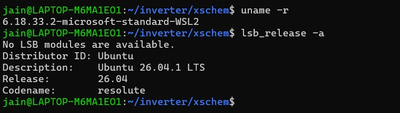

## 4. Stage 1: Environment setup

### 4.1 GUI check

xschem, magic and netgen are graphical, so the display must work.

```bash
echo $DISPLAY                                   # :0
sudo apt update && sudo apt install -y x11-apps # 10 packages
xeyes                                           # two eyes window appeared
```

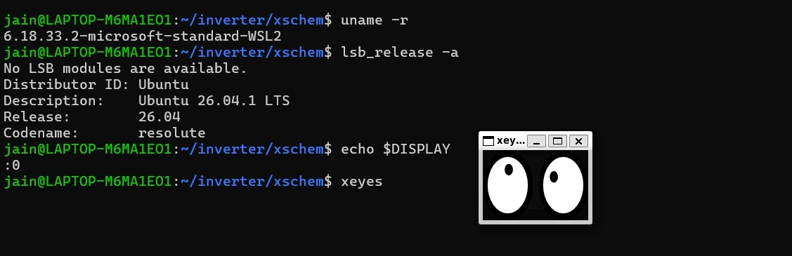

### 4.2 System update

```bash
sudo apt upgrade -y
```

69 packages upgraded (including `openssl`, `sudo`, `libx11`, `mesa`). Two packages were held back by Ubuntu's phased updates, which is normal.

### 4.3 More memory for WSL

The default 3.7 GB can run out during the PDK build, so I raised it. In Windows PowerShell:

```powershell
notepad $env:USERPROFILE\.wslconfig
```

```ini
[wsl2]
memory=5GB
swap=6GB
```

```powershell
wsl --shutdown
```

After reopening Ubuntu, `free -h` showed 4.8 GiB RAM and 6.0 GiB swap.


## 5. Stage 2: Installing the tools

Checked availability first, since Ubuntu 26.04 is very new:

```bash
apt-cache policy magic ngspice netgen-lvs xschem iverilog klayout
sudo apt install magic ngspice netgen-lvs xschem klayout
sudo apt install -y git build-essential python3
```

| Tool | Purpose | Version |
|---|---|---|
| magic | layout, extraction | 8.3.105 from apt (replaced, see Stage 3) |
| ngspice | simulation | 45.2 |
| xschem | schematic | 3.4.4 |
| netgen-lvs | LVS | 1.5.133-1.2 |
| klayout | optional layout viewer | 0.30.0 |
| iverilog | digital simulation (already present, not needed) | 12.0 |

About 425 MB of dependencies (Qt5, Tcl/Tk, Ruby) came with these. The first `xschem --version` created `~/.xschem`.


## 6. Stage 3: Building a newer magic

### 6.1 First PDK attempt failed

```bash
cd ~
git clone https://github.com/RTimothyEdwards/open_pdks
cd open_pdks
./configure --enable-sky130-pdk
make 2>&1 | tee ~/make.log
```

```
sky130A.tech: line 6042: section extract:
        Malformed line for keyword device.  Correct usage:
...
SystemError: Command magic failed with exit code: -11
make: *** [Makefile:132: tech-sky130] Error 2
```

- **"Malformed line for keyword device":** `sky130A.tech` uses commands newer than my magic understood.
- **Exit code -11:** magic crashed (segmentation fault) as a result.

**Diagnosis:** `magic --version` gave 8.3.105 (apt), while `open_pdks` was the latest main branch. Magic was too old, so I needed a newer one from source.


### 6.2 Build dependencies

```bash
sudo apt update
sudo apt install -y build-essential git m4 tcsh csh tcl-dev tk-dev \
  libx11-dev libxext-dev libcairo2-dev libglu1-mesa-dev freeglut3-dev \
  mesa-common-dev zlib1g-dev libncurses-dev
```

### 6.3 Compile failed, then fixed

```bash
cd ~
git clone https://github.com/RTimothyEdwards/magic
cd magic
./configure
make
```

```
CMWmain.c:228:9: error: too many arguments to function 'WindMove'; expected 0, have 2
```

**Cause:** magic uses old C style `extern void WindMove();` (arguments unspecified). The new compiler defaults to a newer C standard where empty parentheses mean "no arguments".

**Fix:** use the `gnu17` C standard.

```bash
make distclean
CFLAGS="-g -std=gnu17" ./configure
grep -n "gnu17" defs.mak          # confirms CFLAGS = -g -std=gnu17 ...
make 2>&1 | tee ~/magic-build.log
sudo make install
hash -r
which magic                       # /usr/local/bin/magic
magic --version                   # 8.3.685
```

`/usr/local/bin` takes priority over the old `/usr/bin/magic`.

## 7. Stage 4: Installing the SKY130 PDK

```bash
cd ~/open_pdks
make distclean
./configure --enable-sky130-pdk
make 2>&1 | tee ~/make.log
sudo make install
```

The build ended with `Done.` The `No CDL file contains ...` lines are informational notes about I/O pad cells. Searching the log for "ERROR" only matches the script's own `echo "*** ERROR: ..."` text, printed only if a stage fails.

```
$ ls /usr/local/share/pdk
scripts  sky130A  sky130B
$ ls /usr/local/share/pdk/sky130A
libs.ref  libs.tech
```

`sky130A` is the variant used in all labs.


## 8. Stage 5: Verification, project folder and xschem

### 8.1 Does magic load the PDK?

**Wrong test:** `-T sky130A` alone printed `Could not find file 'sky130A.tech'` and fell back to `minimum`. Magic only searches its own folders with that option, so this did not mean the install was broken.

**Correct test:** use the PDK's startup file.

```bash
magic -dnull -noconsole -rcfile /usr/local/share/pdk/sky130A/libs.tech/magic/sky130A.magicrc <<'EOF'
puts "tech loaded: [tech name]"
quit -noprompt
EOF
```

```
Using technology "sky130A", version 1.0.588-90-g0ec4fa6
tech loaded: sky130A
```

No "Malformed line" messages, so the original problem is fixed. The `RLIMIT_NOFILE is above 1024` warning can be ignored.


### 8.2 Environment variables

```bash
echo 'export PDK_ROOT=/usr/local/share/pdk' >> ~/.bashrc
echo 'export PDK=sky130A' >> ~/.bashrc
source ~/.bashrc
echo "PDK_ROOT=$PDK_ROOT PDK=$PDK"
```

### 8.3 Project folder and PDK shortcuts (from video 2)

In the video the lecturer creates a project folder with one subfolder per tool, then makes shortcuts (symbolic links) to the PDK setup files. Each tool reads its setup file from the folder where it is started. His PDK is under `/usr/share/pdk`; mine is under `/usr/local/share/pdk`, so I used my path.

```bash
cd
mkdir inverter
cd inverter
mkdir xschem
mkdir mag
mkdir netgen
cd xschem
ln -s /usr/local/share/pdk/sky130A/libs.tech/ngspice/spinit .spiceinit
cd ../mag
ln -s /usr/local/share/pdk/sky130A/libs.tech/magic/sky130A.magicrc .magicrc
cd ../netgen
ln -s /usr/local/share/pdk/sky130A/libs.tech/netgen/sky130A_setup.tcl setup.tcl
```

The `xschemrc` file is handled differently, see 8.4. I checked each link with `ls -la` and `head -3`, and every one pointed to a real file.

| File | What it does |
|---|---|
| `xschemrc` | tells xschem where the SkyWater symbols are |
| `.spiceinit` | ngspice startup file for that folder |
| `.magicrc` | makes magic load sky130A when started from `mag/` |
| `setup.tcl` | rules netgen uses for LVS |

Small mistake on the way: my first `xschemrc` link used a wrong path (`/usr/share/pdk/sky130A/libs.tech/xschemrc`, missing both `local` and the `xschem` folder). `ln -s` does not check that the target exists, so it created a broken link without any error. I found it with `ls -la`, removed it with `rm xschemrc`, and recreated it.

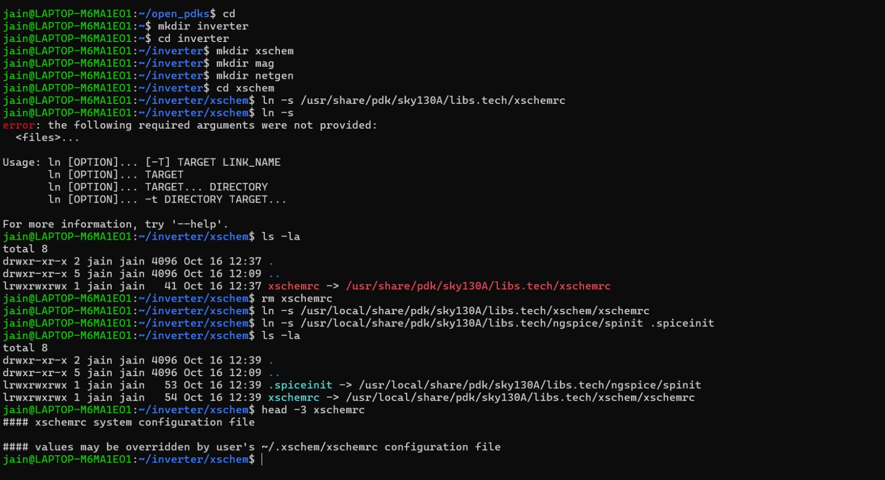

### 8.4 xschem showed MISSING SYMBOL, and the fix

**Symptom.** Starting `xschem` from `~/inverter/xschem` opened the welcome page `top.sch`, but every part was a yellow **MISSING SYMBOL** box. The terminal printed many lines like:

```
l_s_d(): Symbol not found: sky130_tests/test_nmos.sym
l_s_d(): Symbol not found: sky130_fd_pr/nfet_01v8.sym
```

**What I checked.**

```bash
echo $PDK_ROOT $PDK                                          # /usr/local/share/pdk sky130A
ls /usr/local/share/pdk/sky130A/libs.tech/xschem/sky130_tests   # test_nmos.sym etc. exist
```

So the PDK and the symbol files were fine, and xschem even printed "open_pdks installation: using /usr/local/share/pdk". The problem was xschem's symbol search list.

```bash
grep -n "LIBRARY_PATH\|START_WINDOW\|info script\|PWD" xschemrc
```

Line 34 of the PDK's `xschemrc` adds "the folder where this file lives" to the search list:

```
append XSCHEM_LIBRARY_PATH :[file dirname [file normalize [info script]]]
```

**Cause.** My `xschemrc` was a shortcut. Tcl does not follow the shortcut to its real location, so xschem added my project folder `~/inverter/xschem` to the search list instead of the PDK folder, and found no SkyWater symbols there.

**Fix.** Replace the shortcut with a one line file that loads the PDK's own `xschemrc`, so the line above sees the real PDK path:

```bash
cd ~/inverter/xschem
rm xschemrc
echo 'source /usr/local/share/pdk/sky130A/libs.tech/xschem/xschemrc' > xschemrc
cat xschemrc
xschem
```

**Result.** The welcome page now shows real SkyWater symbols (varactors, MIM capacitors, PFET, NFET, resistors, diodes) instead of MISSING SYMBOL boxes.

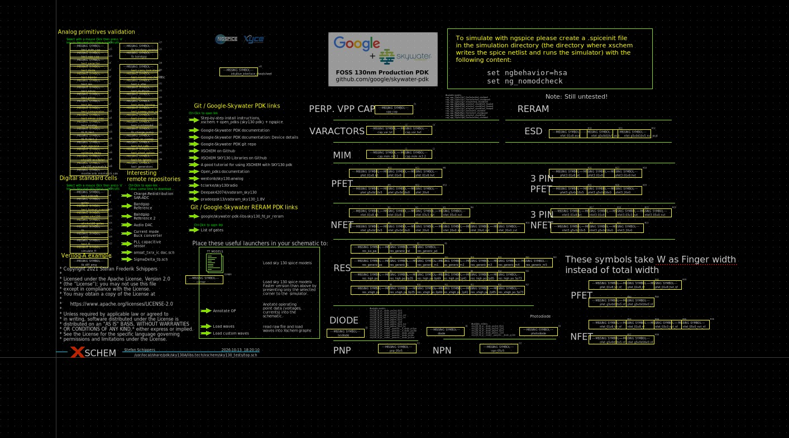

*Before the fix: the PDK welcome page shows MISSING SYMBOL boxes.*

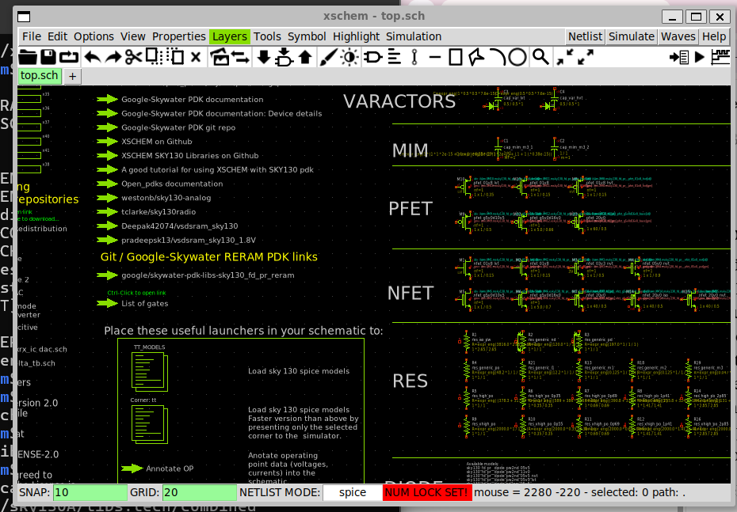

*After the fix: the same welcome page shows real SkyWater symbols.*

### 8.5 magic with the PDK and the device generator (from video 2)

**Start magic from the `mag` folder** so that it reads the `.magicrc` shortcut:

```bash
cd ~/inverter/mag
magic
```

The top bar shows `Technology: sky130A`, the menus **Devices 1** and **Devices 2** appear, and the layer palette on the right lists the SKY130 layers (dnwell, nwell, pwell, ntransistor, ndiffusion and so on). In video 1 the same window said `Technology: minimum`, because there was no PDK shortcut in that folder.


**Graphics option.** The video starts magic with `magic -d XR`. I tried `magic`, `magic -d XR` and once `magic d OGL` (typed without the dash, so magic read `d` and `OGL` as file names, which did no harm). On my laptop the `-d XR` window showed a black, empty canvas, while plain `magic` showed the normal gray canvas and drew correctly, so I used plain `magic` for the rest of the lab.

**Box and paint test.** In the magic console I tested that drawing works:

```
box size 2um 1um
paint ndiffusion
select area
what
```

`what` printed `ndiff`. A green rectangle appeared, together with a dotted pattern, because a lone diffusion rectangle breaks the design rules. I removed it with `undo`.


**Device generator.** From the **Devices 1** menu I chose **nmos (MOSFET)**. A parameter window opened (width, length, fingers, M, device type, guard ring options). I set the values as shown in the video, clicked **Create and Close**, and a transistor with fingers and a guard ring was drawn. I then drew it with and without the guard ring, and changed the device type to the 5 V nfet `sky130_fd_pr__nfet_g5v0d10v5`.

<!-- TODO: write the width, length and fingers values you really used -->


**What is selected.** With the transistor selected, `what` printed:

```
Selected subcell(s):
    Instance "sky130_fd_pr__nfet_g5v0d10v5_GD5FSW_0" of cell "sky130_fd_pr__nfet_g5v0d10v5_GD5FSW"
```

In the video the output lists mask layers instead. The difference is that I had selected the whole generated device (an instance of a cell). After typing `edit`, then `select area` and `what`, magic listed the layers inside the device: `mvnmos`, `mvndiff`, `mvndiffc`, `poly`, `polycont`, `locali`, `viali` and `metal1`, plus the labels D0, D2, S1, G0, G1 and G2.


This 5 V transistor was only for following the video. The inverter uses the 1.8 V devices.

### 8.6 Tool start tests (from video 1)

In video 1 the lecturer starts each tool in three ways: normally, with `-noconsole`, and with `-dnull`. I repeated this from my home folder, where there is no PDK shortcut, so magic uses its built in `minimum` technology, as in the video.

```bash
cd ~
netgen-lvs -noconsole
magic -noconsole
magic -dnull -noconsole
cat > test.tcl        # type: quit, press Enter, then Ctrl+D
magic -dnull -noconsole test.tcl
```

Results:

* `netgen-lvs -noconsole` printed `Netgen 1.5.133` and gave a `%` prompt in the terminal. `quit` closed it. (The command is `netgen-lvs` on my system, see section 10. The lecturer's version is 1.5.166.)
* `magic -noconsole` printed `Magic 8.3 revision 685` and `Using the terminal as the console`, opened the layout window with `Technology: minimum`, and gave a `%` prompt in the terminal. (The lecturer's magic is revision 140.)
* `magic -dnull -noconsole` printed `Using NULL graphics device`: magic runs with no window at all. `quit` closed it.
* `magic -dnull -noconsole test.tcl` printed `Loading "test.tcl" from command line.` and returned to the shell by itself, because the script only contains `quit`.

xschem and ngspice were started in later steps (sections 8.4 and 9.4).


## 9. Stage 6: Inverter lab

Circuit: a CMOS inverter (one NMOS, one PMOS), taken through the flow from the last lab of the videos.

```
inverter/
├── xschem/   (inverter.sch, inverter.sym, inverter_tb.sch, xschemrc, .spiceinit)
├── mag/      (inverter.mag, inverter.ext, inverter.spice, inverter_tb.spice, .spiceinit, .magicrc)
└── netgen/   (setup.tcl, LVS output)
```

| Step | Tool |
|---|---|
| 0. Open each tool with the PDK | xschem, magic |
| 0. Start netgen (the command is `netgen-lvs` on my system) | netgen |
| 1. Schematic, symbol, testbench | xschem |
| 2. Transient simulation and waveform | ngspice |
| 2b. LVS netlist of the inverter (`inverter.spice`) | xschem |
| 3. Layout | magic |
| 4. Extract layout netlist | magic |
| 5. LVS | netgen-lvs |
| 6. Post-layout simulation | ngspice |

### 9.1 Library list check

Opening the Insert symbol window (Ctrl+I) showed three library lines but not my project folder. The cause was my one line `xschemrc` (see 8.4): it only loads the PDK file. I appended one line to it so that my project folder is searched too:

```bash
cd ~/inverter/xschem
echo 'append XSCHEM_LIBRARY_PATH :[file dirname [file normalize [info script]]]' >> xschemrc
cat xschemrc
```

The file now has two lines, and the library list shows four entries, including `/home/jain/inverter/xschem`.


### 9.2 Schematic and symbol

I opened a new tab with **File, Create new window/tab**, so the PDK welcome page `top.sch` stayed unchanged. The inverter schematic `inverter.sch` contains:

* NMOS `sky130_fd_pr__nfet_01v8`, W=4.5, L=0.18, nf=3, source and body to `vss`
* PMOS `sky130_fd_pr__pfet_01v8`, W=3, L=0.18, nf=3, source and body to `vdd`
* Gates tied together to `in`, drains tied together to `out`
* Pins `in`, `out`, `vdd`, `vss`

I created the symbol `inverter.sym` from the schematic.

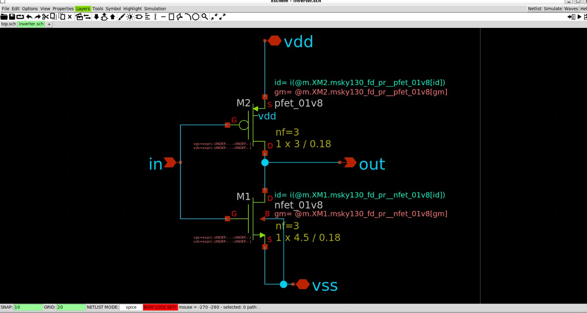

### 9.3 Testbench

The testbench `inverter_tb.sch` places the inverter symbol and adds:

* `V2`, a 1.8 V supply on `vdd`
* `V1`, an input source `PWL(0 0 20n 0 900n 1.8)`, a ramp from 0 V to 1.8 V
* A `.lib` line that loads the SkyWater models: `.lib /usr/local/share/pdk/sky130A/libs.tech/ngspice/sky130.lib.spice tt`
* A control block: `.control`, `tran 1n 1u`, `plot V(in) V(out)`, `.endc`

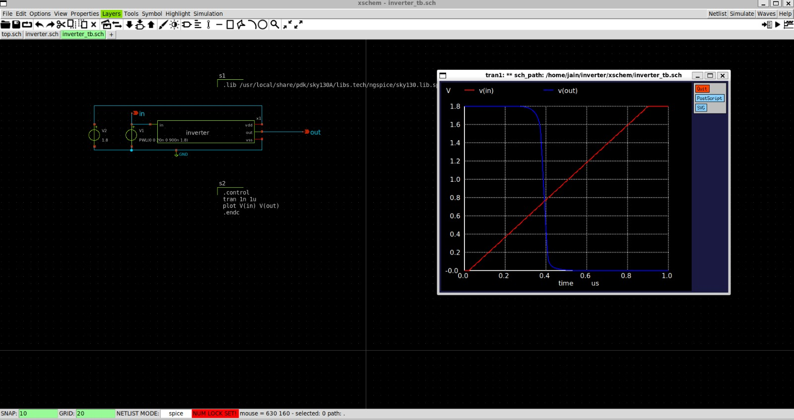

### 9.4 Running the simulation

I clicked **Netlist** and then **Simulate**. xschem writes the netlist to `~/.xschem/simulations/inverter_tb.spice` and runs ngspice there. This stage took several fixes, listed in section 10. To see errors directly, I also ran ngspice by hand:

```bash
cd ~/.xschem/simulations
ngspice inverter_tb.spice
```

To confirm that no unevaluated parameters were left in the netlist:

```bash
grep -n "expr\|@" ~/.xschem/simulations/inverter_tb.spice
```

It printed nothing, and ngspice ran without errors.

### 9.5 Result

In the plot, `v(in)` is a ramp from 0 V to 1.8 V. `v(out)` starts at 1.8 V and falls sharply to 0 V at about 0.4 microseconds, when the input is at roughly 0.8 V (read from the plot, so approximate). The output is the inverse of the input, so the inverter works.

The input ramp is slow, so this test shows where the inverter switches, not how fast it is. I did not measure a propagation delay.

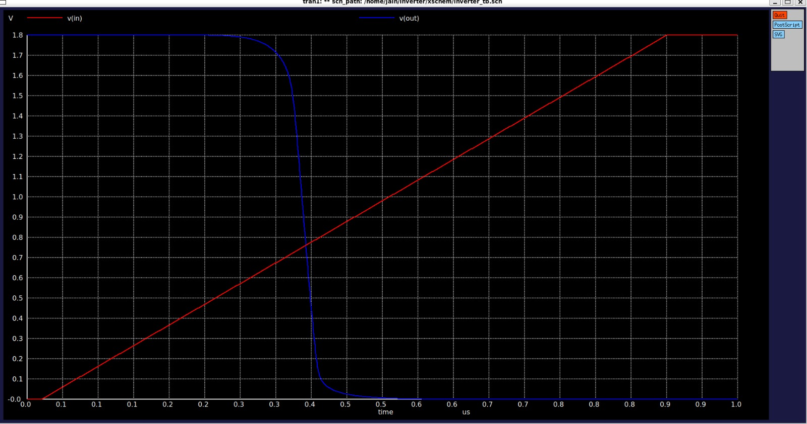

### 9.6 LVS netlist of the inverter

Following the video, after the simulation I made a second netlist, this time of the inverter alone, for the layout and LVS stages:

1. Quit the plot window and ngspice.
2. Opened the `inverter.sch` tab and saved it (Ctrl+S).
3. In the **Options** menu I ticked the LVS netlist entry, which writes the top level circuit as a `.subckt`.
4. Clicked **Netlist** in the `inverter.sch` tab.

<!-- TODO: write the exact name of the Options menu entry you ticked -->

xschem wrote the file to `~/.xschem/simulations/inverter.spice`, not to my project folder as in the video. I found it and copied it next to my schematic, so that the file dialog in magic finds it in the same place as in the video:

```bash
find ~ -name "inverter.spice" 2>/dev/null
cp ~/.xschem/simulations/inverter.spice ~/inverter/xschem/
cat ~/inverter/xschem/inverter.spice
```

The file contains:

```
** sch_path: /home/jain/inverter/xschem/inverter.sch
.subckt inverter in out vdd vss
*.PININFO in:I out:O vdd:B vss:B
XM1 out in vss vss sky130_fd_pr__nfet_01v8 L=0.18 W=4.5 nf=3 m=1
XM2 out in vdd vdd sky130_fd_pr__pfet_01v8 L=0.18 W=3 nf=3 m=1
.ends
.end
```

I checked that it has the four pins `in`, `out`, `vdd`, `vss`, an NMOS and a PMOS with the sizes of my schematic, no `expr` or `@` text, and a closing `.ends`. This is the file magic imports for the layout, and the one netgen compares against later.


### 9.7 Layout in magic

The layout cell is `inverter.mag` in the `mag/` folder. Magic must be started from `mag/` so that it reads the `.magicrc` shortcut and loads `sky130A`. I used plain `magic`, because `magic -d XR` gave a black canvas on my laptop (see 8.5).

```bash
cd ~/inverter/mag
magic inverter
```

The layout uses the same 1.8 V devices as the schematic, with the same total sizes. The extracted netlist later showed it:

| Device | Layout | Total |
|---|---|---|
| NMOS `sky130_fd_pr__nfet_01v8` | 3 fingers, W = 1.5 µm each, L = 0.18 µm | W = 4.5 µm |
| PMOS `sky130_fd_pr__pfet_01v8` | 3 fingers, W = 1 µm each, L = 0.18 µm | W = 3 µm |

The pins are `in`, `out`, `vdd` and `vss`. Magic saved the two generated transistors as their own cells (`sky130_fd_pr__nfet_01v8_KBZXWL.mag` and `sky130_fd_pr__pfet_01v8_XQ58Y7.mag`) next to `inverter.mag`.

<!-- TODO: write how you drew the layout (imported inverter.spice or drew the devices yourself) -->

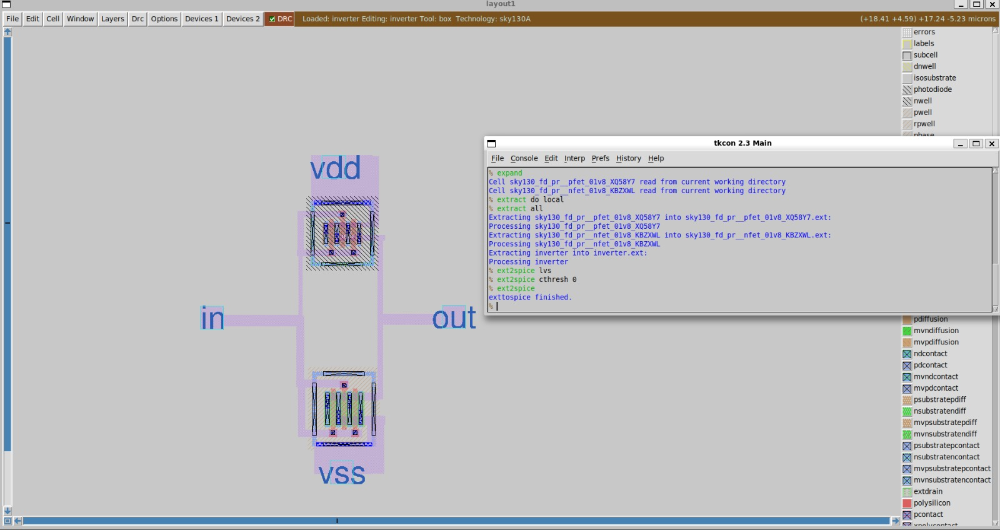

### 9.8 Extraction

Extraction turns the layout back into a circuit. Before extracting, I removed the old `.ext` files, as in the video:

```bash
cd ~/inverter/mag
rm *.ext
magic inverter
```

In the magic console:

```
extract do local
extract all
ext2spice lvs
ext2spice
quit
```

| Command | What it does |
|---|---|
| `extract do local` | writes the `.ext` files into the `mag/` folder |
| `extract all` | extracts the layout into `inverter.ext` (and one `.ext` file per device cell) |
| `ext2spice lvs` | selects the LVS style of netlist, **without** parasitic capacitors |
| `ext2spice` | converts the `.ext` files into `inverter.spice` |


### 9.9 LVS with netgen-lvs

LVS compares the extracted layout netlist with the schematic netlist from section 9.6. On my system the LVS tool is `netgen-lvs` (the name `netgen` starts a different program, see section 10).

```bash
cd ~/inverter/netgen
netgen-lvs -batch lvs "../mag/inverter.spice inverter" "../xschem/inverter.spice inverter" setup.tcl
```

Each quoted part is a file name followed by the circuit name, and `setup.tcl` is my shortcut to the SKY130 LVS rules (section 8.3).

**First run: mismatch.** I had extracted the layout with the parasitic capacitors, so netgen found 60 devices in the layout and 2 in the schematic:

```
Class: sky130_fd_pr__nfet_01v8   instances:   1
Class: c                         instances:  58
Class: sky130_fd_pr__pfet_01v8   instances:   1
Circuit 1 contains 60 devices, Circuit 2 contains 2 devices. *** MISMATCH ***
Result: Netlists do not match.
```

The transistors and the 4 nets already agreed. Only the 58 capacitors (`Class: c`) were extra, because the schematic has no capacitors.

**Fix.** Extract again in the LVS style (`ext2spice lvs`, then `ext2spice`, section 9.8) and run netgen again. The result is:

```
Result: Circuits match uniquely.
```

The layout has 3 NMOS fingers and 3 PMOS fingers. Netgen merges parallel devices (the `Combined 3 parallel devices` lines), so each side ends with 1 NMOS, 1 PMOS and 4 nets.

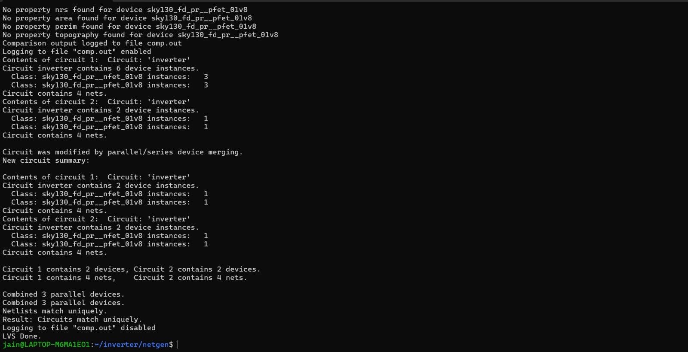

### 9.10 Post-layout simulation

Last part of the video: simulate the extracted layout, with parasitic capacitors included, and compare it with the schematic simulation. LVS had to pass first, because this step overwrites `mag/inverter.spice` with the parasitic version.

**1. Extract with parasitic capacitors.** In the magic console (this time without `lvs`):

```
extract do local
extract all
ext2spice cthresh 0
ext2spice
quit
```

The video uses `ext2cthresh 0`. That command does not exist in my magic 8.3.685 (`invalid command name "ext2cthresh"`). The same setting is `ext2spice cthresh 0`, typed before the final `ext2spice`.

**2. Copy the testbench and the ngspice setup into `mag/`.**

```bash
cd ~/inverter/mag
cp ~/.xschem/simulations/inverter_tb.spice .
cp ../xschem/.spiceinit .
```

The video copies `../xschem/inverter_tb.spice`, but on my system xschem writes the netlist to `~/.xschem/simulations/`, so I copied it from there. The `.spiceinit` sets `SCALE` to 1e-6, which ngspice needs to read the extracted widths (`w=1.5`) as micrometres.

**3. Edit the testbench** with `vi inverter_tb.spice`:

* Deleted the block that starts with `* expanding symbol: inverter.sym` and ends with its `.ends`. This is the schematic version of the inverter. The layout version replaces it.
* Added `.include inverter.spice` just before `.GLOBAL GND`.
* Kept the `.lib` line with my path `/usr/local/share/pdk/sky130A/libs.tech/ngspice/sky130.lib.spice tt`.

In vi: press `o` to open a new line and type, `Esc` to leave insert mode, then `:wq` to save and quit (`:q!` quits without saving).

**4. Add the `.subckt` wrapper to the extracted netlist.** The first run of ngspice stopped with:

```
Error: unknown subckt: x1 in out 0 net1 inverter
```

The extracted `inverter.spice` was a flat list of transistors (`X0` to `X5`) and capacitors (`C0` to `C5`) with no `.subckt inverter` line, so the testbench had nothing to call. I added the wrapper with the pin order that xschem uses for the inverter (found with `grep -n "subckt inverter" ~/.xschem/simulations/inverter_tb.spice`, which printed `.subckt inverter vdd in out vss`):

```bash
cp inverter.spice inverter_flat.spice          # backup
sed -i '1a .subckt inverter vdd in out vss' inverter.spice
echo ".ends" >> inverter.spice
```

**5. Match the pin order in the testbench.** ngspice connects the pins of a subcircuit by **position**, not by name. The `x1` line of my testbench listed the pins in a different order than the `.subckt` line, so I rewrote it:

```bash
sed -i 's/^x1 .*/x1 net1 in out GND inverter/' inverter_tb.spice
grep -n "^x1" inverter_tb.spice                # 5:x1 net1 in out GND inverter
```

Here `net1` is the supply node. In the video the supply wire has a `vdd` label in xschem. Mine has no label, so xschem named it `net1` automatically. The name does not matter, as long as `V2 net1 GND 1.8` and the `x1` line use the same one.

**6. Run the simulation.**

```bash
ngspice inverter_tb.spice
```

**Result.** `v(in)` is a ramp from 0 V to 1.8 V. `v(out)` starts at 1.8 V and falls sharply to 0 V at about 0.4 microseconds, when the input is at roughly 0.8 V (read from the plot, so approximate). This is the same switching point as the schematic simulation in 9.5, so the layout behaves like the schematic. The input ramp is slow and the parasitic capacitors are only a few femtofarads, so this test shows that the layout switches correctly, not how fast it is. Two warnings appeared (`m=xx on .subckt line will override multiplier m hierarchy` and `Missing charsets in String to FontSet conversion`) and did not affect the result.

Re-extracting in magic overwrites `inverter.spice`, so the `.subckt` wrapper has to be added again after every extraction. Also, never run LVS on this parasitic version.

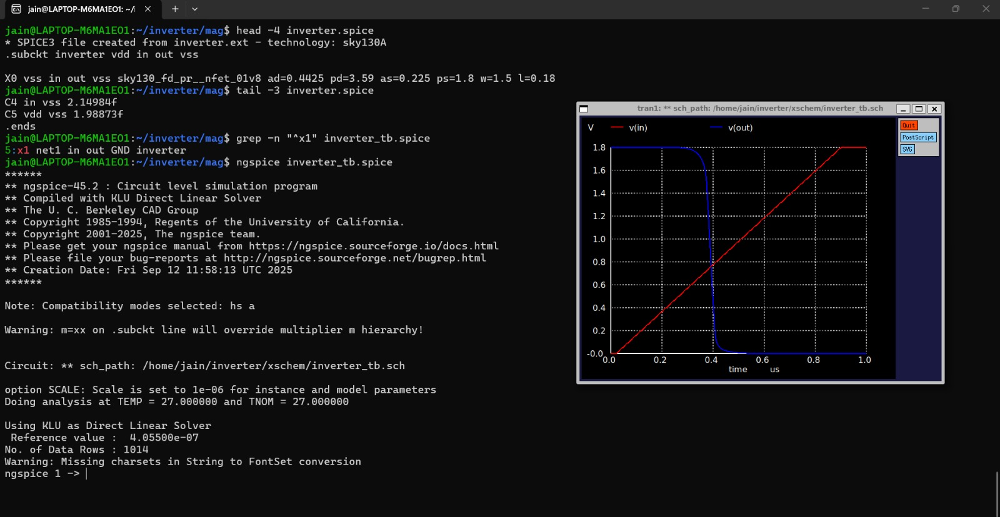

With this, the whole flow of the last lab is finished: schematic, simulation, layout, extraction, LVS and post-layout simulation.

## 10. Problems and fixes

| Problem | Cause | Fix |
|---|---|---|
| `make` in open_pdks: "Malformed line for keyword device", magic exit -11 | apt magic 8.3.105 too old for the current PDK | Build magic from source (8.3.685) |
| magic compile: "too many arguments to function 'WindMove'" | Newer compiler defaults to a C standard where `()` means no arguments | `CFLAGS="-g -std=gnu17" ./configure` |
| `magic -T sky130A`: "Could not find file 'sky130A.tech'" | Option only searches magic's own folders | Test with `-rcfile .../sky130A.magicrc` |
| Build risked running out of memory | WSL default 3.7 GB RAM, 1 GB swap | `.wslconfig`: 5 GB RAM, 6 GB swap |
| `ln -s` ran without error but the link pointed to nothing | I typed a wrong target path; `ln -s` does not check that the target exists | `ls -la` showed the broken link; `rm` it and recreate with the correct path |
| xschem: yellow MISSING SYMBOL boxes, "Symbol not found" lines | `xschemrc` was a shortcut, so xschem searched my project folder instead of the PDK folder (line 34 of the PDK's `xschemrc`) | Replace the shortcut with a file containing `source /usr/local/share/pdk/sky130A/libs.tech/xschem/xschemrc` |
| Insert symbol window: my project folder missing from the library list | My `xschemrc` only sourced the PDK file | Appended `append XSCHEM_LIBRARY_PATH :[file dirname [file normalize [info script]]]` to `xschemrc` |
| `magic -d XR`: black, empty canvas | Unknown (graphics option on my WSL setup) | Used plain `magic`, which drew correctly |
| Netlist and Simulate: no window opened | `xterm` was not installed | `sudo apt install xterm` |
| ngspice did not read my `.spiceinit` | xschem runs ngspice in `~/.xschem/simulations`, not in my project folder | Made the `.spiceinit` shortcut in `~/.xschem/simulations` too |
| ngspice: `unknown subckt` for the nfet | The `.lib` line had the lecturer's path `/usr/share/pdk` and no space after `.lib` | Corrected to `.lib /usr/local/share/pdk/sky130A/libs.tech/ngspice/sky130.lib.spice tt` |
| ngspice errors in the control block and source | `trans ln lu` used the letter l instead of the digit 1, and the PWL source had an incomplete time and voltage pair | `tran 1n 1u` and `PWL(0 0 20n 0 900n 1.8)` |
| ngspice: `Undefined parameter [expr]` | xschem 3.4.4 did not evaluate the `expr()` parameters of the PDK transistor symbols, so `@nf` and `@W` reached ngspice | Rewrote `ad`, `pd`, `as`, `ps`, `nrd`, `nrs` of both transistors in ngspice style, for example `ad="'int((nf + 1)/2) * W / nf * 0.29'"` |
| `netgen` opened a different program (a mesh generator, NETGEN 6.2) and failed with `libnggui.so` | The name `netgen` belongs to that other program. The LVS tool from the `netgen-lvs` package is installed as `/usr/bin/netgen-lvs` | Start the LVS tool with `netgen-lvs`; it opens a console showing Netgen 1.5.133 |
| `netgen netgen-lvs -batch lvs ...`: the same `libnggui.so` error as before | I typed the tool name twice, so the first `netgen` started the mesh generator program | Type only `netgen-lvs -batch lvs "..." "..." setup.tcl` |
| LVS: `Class: c instances: 58`, `*** MISMATCH ***`, `Netlists do not match` | The layout netlist was extracted with parasitic capacitors, and the schematic has none | Extract again with `ext2spice lvs`, then `ext2spice`, and run LVS again |
| magic: `invalid command name "ext2cthresh"` | The lecturer's magic (revision 140) is older. The command does not exist in magic 8.3.685 | `ext2spice cthresh 0` before `ext2spice` |
| vi: `E325: ATTENTION`, swap file `.inverter.spice.swp` already exists | An earlier vi session was closed by closing the terminal | Press `D` (delete it) because the swap file was older than the file. Leave vi with `:wq` or `:q!`, never by closing the terminal |
| `cp ../xschem/inverter_tb.spice .`: No such file or directory | xschem writes the testbench netlist to `~/.xschem/simulations/`, not to my project folder | `cp ~/.xschem/simulations/inverter_tb.spice .` |
| `cp: missing destination file operand` | I left out the `.` (current folder) at the end of the command | `cp <source> .` |
| ngspice: `unknown subckt: x1 in out 0 net1 inverter` | The extracted `inverter.spice` was a flat list of devices with no `.subckt inverter` wrapper | Insert `.subckt inverter vdd in out vss` after the first line and add `.ends` at the end (section 9.10) |
| Testbench pins connected in the wrong order | ngspice connects subcircuit pins by position, and the `x1` line used a different order than the `.subckt` line | Rewrote it as `x1 net1 in out GND inverter` to match `vdd in out vss` |
| vi: could not paste or add a new line | vi starts in normal mode, where typed text is read as commands | Press `o` to insert a line, type the text, then `Esc` and `:wq`. Paste with Ctrl+Shift+V |

## 11. Lessons learned

- Check tool versions against what the PDK needs. A package manager version can be too old.
- Read the first error in a log, not the last. The crash was a result of the "Malformed line" messages.
- A very new OS can break old C code. The `gnu17` standard fixed the build.
- Test the PDK through its own startup file; plain `-T sky130A` is misleading.
- Simulation and LVS each catch a different kind of mistake: the idea, and layout versus plan.
- `ln -s` never checks the target. Always verify a new link with `ls -la` and `head`.
- A shortcut to a setup file is not always the same as the file itself: a script that asks "where am I?" gets the shortcut's location. Read the setup file when a tool cannot find its libraries.
- The terminal messages a tool prints on startup often point straight at the problem.
- When one tool starts another (xschem runs ngspice), the second tool works in its own folder, so its setup files must be there.
- Settings copied from a video need checking: the lecturer's paths, missing spaces, and look alike characters (the letter l and the digit 1) all caused errors.
- A PDK that is newer than the packaged tools can need newer tools or small changes, as with magic and with the xschem transistor parameters.
- Read the error text in the terminal. Every problem in this stage was named in it.
- A project can need two different netlists: the testbench netlist for simulation, and the LVS netlist of the circuit alone for magic and netgen.
- Do the LVS netlist and the simulation netlist as two separate extractions. LVS needs the version without parasitic capacitors, and the post-layout simulation needs the version with them.
- A command from a video can change between tool versions: `ext2cthresh` became `ext2spice cthresh` in my magic.
- ngspice connects the pins of a subcircuit by position. The pin order in the `x1` line must match the `.subckt` line.
- An extracted netlist can be a flat list of devices. A testbench that calls `inverter` needs a `.subckt inverter` wrapper around it.
- Check the file locations on my own system instead of copying the video's paths. xschem netlists are in `~/.xschem/simulations/`.
- Leave vi with `:wq` or `:q!`. Closing the terminal leaves a swap file behind.
